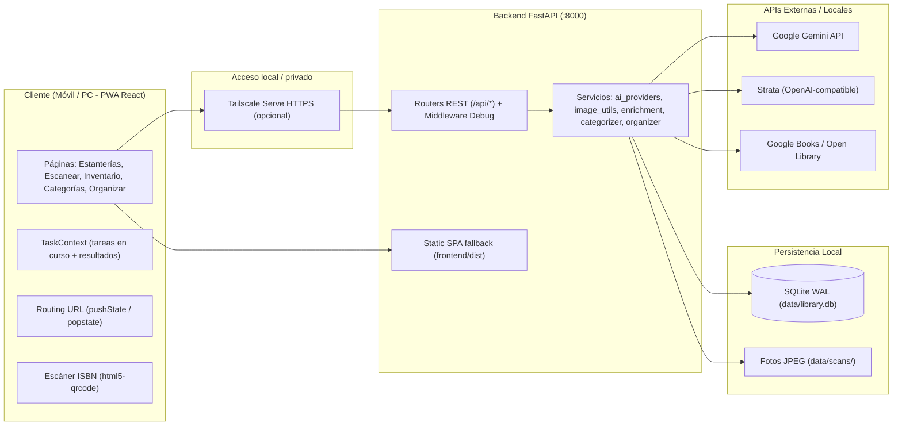
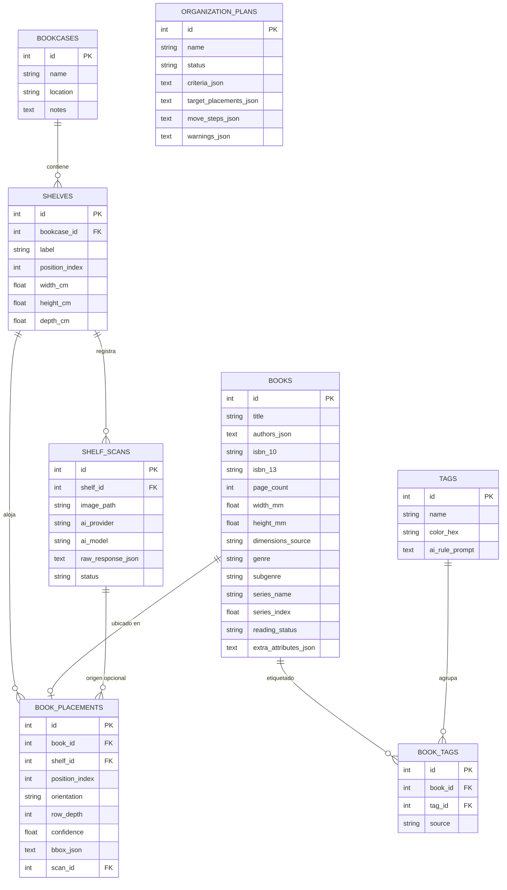
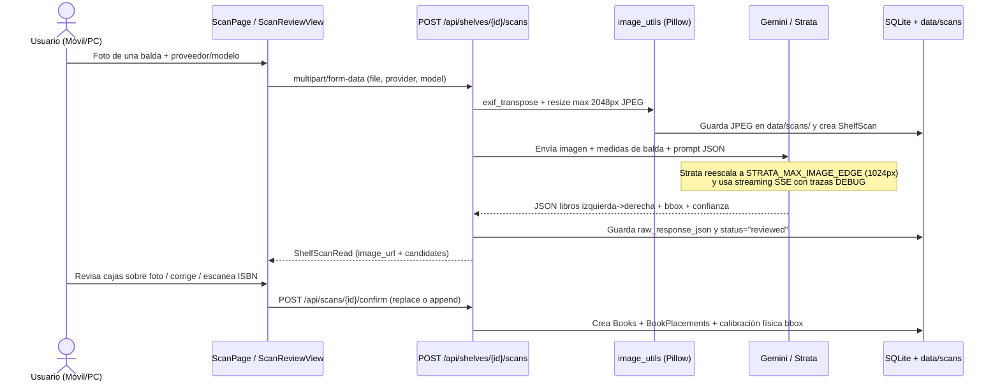

# Documentación Técnica — Mi Biblioteca

Documento de arquitectura, estructura, modelo de datos y lógica de negocio de **Mi Biblioteca**, una aplicación web móvil-first (PWA) autoalojada para escanear estanterías, inventariar libros con IA, categorizarlos dinámicamente y planificar su reorganización física respetando las medidas reales de cada balda.

---

## 1. Visión general y arquitectura

La aplicación sigue una arquitectura **cliente–servidor ligera y autoalojada** diseñada para ejecutarse en un PC dentro de la red local (o privada vía Tailscale HTTPS) sin dependencias externas de infraestructura:

- **Backend**: Python 3.12+ con **FastAPI**, **SQLAlchemy 2.0** y **SQLite** en modo WAL (`data/library.db`). También sirve el build estático del frontend (`frontend/dist/`) para operar desde un único puerto (`:8000`).
- **Frontend**: **React 19 + TypeScript + Vite + Tailwind CSS v4** compilado como **PWA** (`vite-plugin-pwa`).
- **Almacenamiento local**: base de datos SQLite en `data/library.db` y fotografías procesadas de baldas en `data/scans/`.
- **Integraciones externas (opcionales / configurables)**:
  - **Visión y razonamiento IA**: adaptador dual intercambiable entre **Google Gemini** (`generativelanguage.googleapis.com`) y **Strata** (cualquier servidor OpenAI-compatible con visión, ej. Qwen3.8-Flash-Next Gyro-M).
  - **Metadatos bibliográficos**: **Google Books API** (primaria) y **Open Library API** (respaldo y complemento).



### Decisiones de diseño clave
- **Sin análisis ni organización por color de lomos**: el color físico del libro se excluye deliberadamente del reconocimiento y de las reglas de ordenación. En los mapas visuales de estanterías, los lomos se colorean **semánticamente por categoría/sección** para distinguir bloques de un vistazo.
- **Human-in-the-loop**: tanto el reconocimiento visual de lomos como la asignación de categorías personalizadas por IA presentan propuestas editables antes de confirmarlas en la base de datos.
- **Respeto por datos manuales**: las medidas físicas editadas manualmente por el usuario (`dimensions_source = "manual"`) nunca son sobreescritas por procesos automáticos de enriquecimiento.

---

## 2. Estructura del repositorio

```text
library_app/
├── .env.example                    # Plantilla de variables de entorno (sin secretos)
├── .gitignore                      # Excluye .env, data/, .venv/, node_modules/, dist/, *.tsbuildinfo
├── LICENSE                         # Licencia MIT
├── README.md                       # Guía rápida de instalación y uso
├── docs/
│   └── ARCHITECTURE.md             # Esta documentación técnica
├── scripts/
│   └── start-tailscale.sh          # Arranca Tailscale Serve HTTPS + Uvicorn en modo debug
├── data/                           # Generado en ejecución (ignorado en Git)
│   ├── library.db                  # Base de datos SQLite (WAL)
│   └── scans/                      # Fotos JPEG normalizadas de cada balda
├── backend/
│   ├── requirements.txt            # Dependencias fijadas del entorno virtual (.venv)
│   ├── app/
│   │   ├── main.py                 # App FastAPI, logging, middleware HTTP, routers y SPA fallback
│   │   ├── config.py               # Configuración tipada con pydantic-settings (.env)
│   │   ├── database.py             # Motor SQLite (PRAGMA foreign_keys=ON, WAL), SessionLocal, Base
│   │   ├── models.py               # Esquema ORM SQLAlchemy 2.0 completo
│   │   ├── schemas/                # Contratos Pydantic v2 (entrada/salida)
│   │   │   ├── bookcase.py         # Estanterías y baldas
│   │   │   ├── scan.py             # Escaneos, candidatos detectados e ISBN
│   │   │   ├── book.py             # Inventario, enriquecimiento y estadísticas
│   │   │   ├── tag.py              # Categorías personalizadas y categorización IA
│   │   │   ├── organization.py     # Criterios dinámicos, mapas visuales, pasos y planes
│   │   │   └── settings.py         # Estado de proveedores y modelos disponibles
│   │   ├── routers/                # Endpoints REST
│   │   │   ├── health.py           # /api/health, /api/config/status, /api/config/models, test-strata
│   │   │   ├── bookcases.py        # CRUD estanterías/baldas y reordenación de baldas
│   │   │   ├── scans.py            # Subida de fotos, análisis IA, confirmación e ISBN
│   │   │   ├── books.py            # CRUD inventario, filtros, stats y enriquecimiento
│   │   │   ├── tags.py             # CRUD etiquetas, evaluación IA y categorización en lote
│   │   │   └── organization.py     # Sugerencias IA, vista previa, planes y aplicación al inventario
│   │   └── services/               # Lógica de dominio e integraciones
│   │       ├── ai_providers.py     # Adaptador dual Gemini / Strata (SSE streaming + JSON recovery)
│   │       ├── image_utils.py      # EXIF transpose, reescalado y calibración física desde bbox
│   │       ├── isbn_lookup.py      # Búsqueda ISBN (Google Books + Open Library)
│   │       ├── enrichment.py       # Búsqueda por título/autor/ISBN y fusión de metadatos
│   │       ├── categorizer.py      # Normalización de taxonomía y evaluación de reglas en lotes
│   │       └── organizer.py        # Ordenación en cascada, Bin Packing físico y guía de movimientos
│   └── tests/                      # Suite pytest (14 tests de unidad e integración)
│       ├── test_bookcases.py
│       ├── test_scans.py
│       ├── test_books.py
│       ├── test_tags.py
│       └── test_organization.py
└── frontend/
    ├── index.html                  # Shell HTML móvil-first en español
    ├── vite.config.ts              # Vite + React + Tailwind v4 + PWA Workbox
    ├── public/icon.svg             # Icono vectorial de la PWA
    └── src/
        ├── main.tsx                # Punto de entrada React
        ├── App.tsx                 # Routing URL/History, estado global de estanterías y modelo IA
        ├── api/client.ts           # Cliente HTTP tipado para toda la API
        ├── types/library.ts        # Tipos TypeScript compartidos
        ├── utils/navigation.ts     # Mapeo bidireccional pestañas <-> URLs + query params
        ├── context/TaskContext.tsx # Gestor global de tareas asíncronas y resultados pendientes
        ├── components/
        │   ├── Layout.tsx          # Cabecera, navegación responsive y barra global de tareas
        │   ├── AIModelSelector.tsx # Selector de proveedor/modelo con carga en vivo
        │   ├── BookcaseCard.tsx    # Alzado visual proporcional de una estantería
        │   ├── BookcaseModal.tsx   # Alta/edición de estanterías con generador rápido de baldas
        │   ├── ShelfModal.tsx      # Alta/edición de medidas de una balda
        │   ├── ScanReviewView.tsx  # Revisión interactiva con bboxes sobre la foto
        │   ├── IsbnScannerModal.tsx# Escáner de código de barras (cámara en vivo / foto / manual)
        │   ├── BookDetailModal.tsx # Ficha editable del libro, medidas, ubicación y etiquetas
        │   ├── TagModal.tsx        # Creación/edición de categoría personalizada y regla IA
        │   ├── TagEvaluateModal.tsx# Revisión de coincidencias propuestas por IA
        │   ├── TagBooksModal.tsx   # Asignación manual de libros a una categoría
        │   ├── ShelfMapView.tsx    # Comparador visual Antes/Después coloreado por categoría
        │   └── MoveChecklistView.tsx # Guía paso a paso por fases con checkboxes persistentes
        └── pages/
            ├── BookcasesPage.tsx
            ├── ScanPage.tsx
            ├── InventoryPage.tsx
            ├── CategoriesPage.tsx
            └── OrganizePage.tsx
```

---

## 3. Modelo de datos (SQLite)

El esquema ORM está definido en `backend/app/models.py` con claves foráneas activas (`PRAGMA foreign_keys=ON`) y eliminación en cascada para mantener integridad referencial.



### Detalles relevantes del modelo
- **Medidas físicas**: las baldas se almacenan en centímetros (`width_cm`, `height_cm`, `depth_cm`) y los libros en milímetros (`width_mm` = grosor del lomo, `height_mm` = altura). El campo `dimensions_source` registra el origen (`api`, `visual_calibration`, `estimated`, `manual`).
- **Extensibilidad sin migraciones destructivas**: `books.extra_attributes_json` guarda metadatos enriquecidos y estados auxiliares (`is_fiction`, `author_gender`, `author_region`, `enrichment_status`, `enrichment_source`, `enriched_at`).
- **Preparado para casos especiales**: `book_placements` incluye `orientation` (`vertical` | `horizontal`) y `row_depth` (`1` | `2`) para soportar pilas horizontales o doble fila sin refactorizar tablas.

---

## 4. Lógica de negocio y flujos principales

### 4.1. Estanterías y baldas (`routers/bookcases.py`)
- Cada estantería contiene baldas ordenadas de arriba a abajo mediante `position_index` (`0..N-1`).
- Permite crear una estantería con generación rápida de *N* baldas con medidas estándar y luego editar dimensiones, añadir, eliminar (re-normalizando índices) o reordenar baldas individualmente.
- Al serializar cada balda se calcula dinámicamente `book_count` y `used_width_cm` sumando el `width_mm` de los libros ubicados en ella (con `25 mm` por defecto si faltara).

### 4.2. Escaneo visual de baldas, capa IA dual e ISBN (`services/ai_providers.py`, `services/image_utils.py`, `routers/scans.py`)



- **Normalización de imagen**: `process_and_save_scan_image` aplica `ImageOps.exif_transpose` (imprescindible en fotos de móvil para que los `bbox` coincidan con la orientación mostrada en el navegador), convierte a RGB y limita el lado largo a `2048 px`.
- **Adaptador `AIProvider`**:
  - **`GeminiProvider`**: llama a `generateContent` con `responseMimeType: "application/json"`, `temperature: 0.1` e imagen `inlineData`.
  - **`StrataOpenAIProvider`**: llama a `{STRATA_BASE_URL}/chat/completions` en modo **streaming SSE** (`stream: true`) con:
    - Reescalado de imagen en memoria a `STRATA_MAX_IMAGE_EDGE` (por defecto `1024 px`) para reducir tokens de visión sin alterar las coordenadas normalizadas `0..1`.
    - `chat_template_kwargs: {"enable_thinking": false}` cuando `STRATA_ENABLE_THINKING=false` (con fallback automático si el servidor devuelve `400/422`).
    - Logs de progreso cada 5 segundos (`content` y `reasoning` en chars) y soporte tanto de `delta.content` como de `delta.reasoning_content`.
  - **Parser JSON robusto (`_extract_json_payload`)**: elimina bloques `<think>...</think>`, limpia bloques Markdown ```` ```json ````, corrige comas finales (`,}` / `,]`), usa `json.JSONDecoder.raw_decode` para ignorar texto posterior y, como último recurso ante respuestas truncadas, recupera cada objeto libro válido individualmente (`_recover_book_objects`).
  - **Normalización de `bbox`**: acepta coordenadas `0..1` y también `0..1000` (convirtiéndolas automáticamente a `0..1`) descartando cajas degeneradas.
- **Calibración física visual (`estimate_dimensions_from_bbox`)**: al confirmar un escaneo, si un libro no tiene medidas explícitas, se estima su grosor (`dx * shelf_width_cm * 10`) y altura (`dy * shelf_height_cm * 10`), acotados a rangos físicos realistas (`8–95 mm` de grosor y `135 mm` hasta la altura de la balda).
- **Confirmación flexible**:
  - `replace_existing=true`: reemplaza los libros previos de esa balda (evitando duplicados al re-escanear).
  - `replace_existing=false`: añade al final de la balda (útil para baldas anchas fotografiadas en 2 partes).
- **Soporte ISBN (`IsbnScannerModal` + `services/isbn_lookup.py`)**:
  - Tres modos: **cámara en vivo** (`html5-qrcode` en contextos seguros HTTPS/`localhost`), **decodificación desde foto del código de barras** (`scanFile`, operativa incluso en HTTP local) y **entrada manual**.
  - Consulta Google Books por `isbn:{code}` y complementa/respalda con Open Library.

### 4.3. Inventario y enriquecimiento (`services/enrichment.py`, `routers/books.py`)
- **Búsqueda y puntuación (`_score_candidate`)**:
  - Si existe ISBN, consulta exacta por ISBN.
  - Si no existe ISBN, consulta Google Books por `intitle` + `inauthor` (con y sin `langRestrict`) y puntúa cada resultado combinando coincidencia normalizada sin tildes de título (`65%`) y autor (`35%`) más bonificaciones por idioma, portada y páginas. Complementa campos faltantes con Open Library (`search.json`).
- **Estimación de grosor por páginas**: `max(8.0, min(95.0, pages * 0.065 + 4.0))` mm.
- **Estados de enriquecimiento (`enrichment_status`)**:
  - `enriched`: libro enriquecido con éxito o con ≥2 señales objetivas de metadatos (portada, ISBN, páginas, sinopsis, editorial+año).
  - `not_found`: ya se intentó enriquecer sin encontrar coincidencia automática (se excluye de futuros lotes «pendientes» hasta que el usuario reintente o edite título/autor/ISBN).
  - `pending`: pendiente de enriquecimiento.
- **Enriquecimiento en lote (`POST /api/books/enrich-batch`)**: usa `asyncio.Semaphore(4)` para limitar la concurrencia frente a las APIs externas.

### 4.4. Categorización IA y etiquetas dinámicas (`services/categorizer.py`, `routers/tags.py`)
- **Normalización de taxonomía (`categorize_books_batch`)**:
  - Procesa los libros en bloques de `25` unidades enviando los géneros ya presentes en la biblioteca para fomentar consistencia en español.
  - Rellena `genre`, `subgenre`, `series_name`, `series_index` y atributos estructurados en `extra_attributes_json` (`is_fiction`, `author_gender`, `author_region`).
- **Categorías personalizadas con reglas en lenguaje natural (`evaluate_tag_rule_batch`)**:
  - Cada `Tag` puede definir un color (`color_hex`) y un `ai_rule_prompt` (ej. *"Libros cuya autora principal es una mujer"*).
  - La evaluación corre en lotes de `30` libros y devuelve propuestas con `confidence`, `reason` (explicación breve en español) y `already_assigned`, que el usuario revisa y marca en `TagEvaluateModal` antes de aplicarlas (`source="ai_confirmed"`). También admite asignación manual desde `TagBooksModal` y `BookDetailModal`.

### 4.5. Motor de organización física y guía paso a paso (`services/organizer.py`, `routers/organization.py`)

El motor separa el **qué ordenar** (criterios dinámicos) del **dónde cabe físicamente** (empaquetado en baldas) y del **cómo moverlo** (plan de ejecución en fases).

1. **Criterios declarativos (`OrganizationCriteria`)**:
   - `dedicated_sections`: separa subconjuntos (*Pendientes de leer*, una categoría personalizada `tag`, un género o un idioma) al principio, al final o fijados a una estantería/balda concreta.
   - `sort_rules`: lista priorizada de criterios combinables (`genre`, `subgenre`, `author`, `series`, `title`, `reading_status`, `tag`, `fiction_vs_nonfiction`, `language`, `published_year`, `publisher`, `height`, `pages`) con dirección `asc`/`desc`.
   - Alcance y reparto:
     - `bookcase_ids`: limita la reorganización a estanterías específicas (o todas si es `null`).
     - `only_occupied_shelves`: excluye baldas que actualmente tienen 0 libros.
     - `pack_mode`:
       - `balanced` *(por defecto)*: calcula un objetivo suave proporcional (`total_books_width / available_capacity * 1.12`) para repartir libros equilibradamente entre todas las baldas activas e iniciar nuevas secciones en balda nueva cuando la actual supera el `72%` del objetivo.
       - `per_bookcase`: reordena los libros de cada estantería dentro de sus propias baldas sin cruzar libros entre habitaciones/estanterías.
       - `compact`: llena las primeras baldas hasta `100% - free_space_percent` dejando las últimas libres.
   - Restricciones físicas: `free_space_percent` (espacio de holgura horizontal), `height_clearance_mm` (holgura vertical superior), `keep_series_together` y `keep_author_together`.

2. **Ordenación y cohesión de bloques**:
   - Ordenación estable multi-paso de menor a mayor prioridad.
   - `_author_sort_key` extrae el apellido normalizado (manejando partículas como *de*, *del*, *la*, *le*, *van*, *von*) para un orden alfabético natural de biblioteca.
   - `_group_atomic_blocks` agrupa libros consecutivos de una misma saga (o autor, hasta 8 volúmenes) para intentar no partirlos entre dos baldas cuando la balda actual ya está suficientemente llena.

3. **Empaquetado físico (`_pack_group_into_bins`)**:
   - Cada balda calcula `effective_width_mm = width_cm * 10 * (1 - free_space_percent / 100)` y `max_book_height_mm = height_cm * 10 - height_clearance_mm`.
   - Si un libro alto no cabe en la balda actual por altura, busca una balda más alta **sin avanzar el cursor** (para no dejar medio vacía la balda anterior con libros de altura normal) y registra un aviso explicativo.
   - Si ningún estante tiene altura o espacio suficiente, el libro aparece explícitamente en `unplaced_books` con el motivo exacto.

4. **Guía de movimientos en 2 fases (`_generate_move_steps`)**:
   - **Fase 1 (`clear`)**: agrupa por balda de origen todos los libros que cambian de balda (empezando por las baldas de las que salen más libros) para despejarlos en una mesa o zona temporal.
   - **Fase 2 (`place`)**: lista el orden definitivo izquierda → derecha de cada balda cuyo contenido o secuencia haya cambiado (omitiendo las baldas intactas), indicando para cada libro si ya estaba en esa balda o si viene de la mesa temporal.
   - **Persistencia y aplicación**: al guardar un plan (`POST /api/organization/plans`), se guarda una instantánea completa en `organization_plans`. Los checkboxes actualizan `move_steps_json` (`PATCH .../steps`) y el botón final (`POST .../apply`) actualiza transaccionalmente todos los `BookPlacement` en SQLite.

5. **Sugerencias IA (`suggest_organization_with_ai`)**:
   - Construye un perfil resumido de la biblioteca (conteos de géneros, idiomas, pendientes, sagas, etiquetas con IDs y medidas de estanterías/baldas) y pide 3 estrategias distintas optimizadas para encontrar libros rápido.
   - Sanitiza todos los IDs de etiquetas/estanterías/baldas devueltos por la IA antes de construir `OrganizationCriteria` válidos y probables en 1 clic.

---

## 5. Arquitectura del Frontend (React + PWA)

- **Routing real con History API (`utils/navigation.ts` + `App.tsx`)**:
  - Cada pestaña corresponde a una ruta real (`/estanterias`, `/escanear`, `/inventario`, `/categorias`, `/organizar`) con query params (`?shelf=`, `?genre=`, `?tag=`).
  - Navegar entre pestañas ejecuta `history.pushState`; recargar mantiene la pestaña y filtros activos, y el botón **Atrás** del navegador/móvil retrocede por el historial interno de la app.
  - En `vite.config.ts`, Workbox configura `navigateFallback: "index.html"` con `navigateFallbackDenylist: [/^\/api\//]` y el backend (`main.py`) sirve `index.html` para rutas SPA no `/api/*`.
- **Gestor global de tareas (`context/TaskContext.tsx` + `Layout.tsx`)**:
  - Las operaciones largas (escaneo IA, enriquecimiento en lote/individual, categorización IA, evaluación de reglas y sugerencias de organización) se lanzan a través de `TaskProvider`, que permanece montado durante toda la sesión.
  - Mientras una tarea corre, `Layout.tsx` muestra una barra persistente con spinner y segundos transcurridos, más un punto indicador en la pestaña correspondiente.
  - Los resultados pendientes de revisión (`pendingScan`, `pendingTagEvaluation`, `pendingOrgSuggestions`) viven en `TaskContext` para no perderse si cambias de pestaña antes de que terminen; además `dataVersion` dispara recargas automáticas en las vistas afectadas.
- **Selector de modelo IA (`components/AIModelSelector.tsx`)**:
  - Permite alternar entre **Gemini** y **Strata**, cargar dinámicamente los modelos disponibles desde `/api/config/models`, o escribir un ID de modelo manual. La selección se persiste por proveedor en `localStorage`.

---

## 6. Referencia de API REST

| Módulo | Método y ruta | Función |
| :--- | :--- | :--- |
| **Sistema** | `GET /api/health` | Comprobación de vida del backend |
| | `GET /api/config/status` | Proveedores IA configurados, modelo activo y sugeridos (sin secretos) |
| | `GET /api/config/models?provider=` | Consulta en vivo los modelos disponibles en Gemini o Strata |
| | `GET /api/config/test-strata` | Diagnóstico rápido de conexión y modelos cargados en Strata |
| **Estanterías** | `GET /api/bookcases` | Lista estanterías con sus baldas, conteos y ocupación |
| | `POST /api/bookcases` | Crea estantería (opcionalmente con *N* baldas iniciales) |
| | `GET / PATCH / DELETE /api/bookcases/{id}` | Consulta, edita o elimina estantería |
| | `POST /api/bookcases/{id}/shelves` | Añade balda con `width_cm`, `height_cm`, `depth_cm` |
| | `PUT /api/bookcases/{id}/shelves/reorder` | Reordena baldas de arriba a abajo |
| | `PATCH / DELETE /api/shelves/{id}` | Edita o elimina una balda |
| | `GET /api/shelves/{id}/books` | Lista los libros ubicados actualmente en esa balda |
| **Escaneo e ISBN** | `POST /api/shelves/{id}/scans` | Sube foto de balda y ejecuta detección visual IA |
| | `GET /api/shelves/{id}/scans` | Historial de escaneos recientes de una balda |
| | `GET / DELETE /api/scans/{id}` | Recupera un escaneo o lo elimina junto a su foto |
| | `GET /api/scans/{id}/image` | Sirve la fotografía JPEG normalizada del escaneo |
| | `POST /api/scans/{id}/confirm` | Confirma libros revisados (reemplazando o añadiendo) |
| | `GET /api/isbn/{isbn}` | Consulta metadatos por ISBN-10/13 (Google Books + Open Library) |
| **Inventario** | `GET /api/books` | Lista libros con búsqueda `q`, filtros (`bookcase_id`, `shelf_id`, `reading_status`, `genre`, `language`, `tag_id`, `enrichment`) y ordenación |
| | `GET /api/books/stats` | Estadísticas globales del inventario y enriquecimiento |
| | `POST /api/books` | Crea un libro manualmente |
| | `GET / PATCH / DELETE /api/books/{id}` | Consulta, edita metadatos/medidas/ubicación o elimina libro |
| | `POST /api/books/{id}/enrich` | Enriquece un libro concreto |
| | `POST /api/books/enrich-batch` | Enriquece en lote libros pendientes |
| **Categorías** | `GET / POST /api/tags` | Lista o crea categorías personalizadas |
| | `PATCH / DELETE /api/tags/{id}` | Edita o elimina una categoría personalizada |
| | `GET /api/tags/{id}/books` | IDs de libros asignados a la categoría |
| | `POST /api/tags/{id}/assign` | Añade/quita libros en lote a una categoría |
| | `PUT /api/books/{id}/tags` | Reemplaza las categorías asignadas a un libro |
| | `POST /api/tags/{id}/evaluate` | Evalúa con IA qué libros cumplen la regla de la categoría |
| | `POST /api/books/categorize-ai` | Normaliza géneros, subgéneros, sagas y atributos en lote con IA |
| **Organización** | `POST /api/organization/suggest` | Solicita 3 propuestas de organización a la IA |
| | `POST /api/organization/preview` | Calcula encaje físico, mapas Antes/Después y pasos de movimiento |
| | `GET / POST /api/organization/plans` | Lista o guarda planes de reorganización |
| | `GET / DELETE /api/organization/plans/{id}` | Carga o elimina un plan guardado |
| | `PATCH /api/organization/plans/{id}/steps` | Marca/desmarca un paso como completado |
| | `POST /api/organization/plans/{id}/apply` | Aplica el plan actualizando todos los `book_placements` en SQLite |

---

## 7. Configuración, despliegue, logging y tests

### Variables de entorno (`.env`)
| Variable | Valor por defecto | Descripción |
| :--- | :--- | :--- |
| `APP_HOST` / `APP_PORT` | `0.0.0.0` / `8000` | Dirección y puerto del servidor FastAPI |
| `DATA_DIR` | `./data` | Directorio para `library.db` y `scans/` |
| `LOG_LEVEL` | `DEBUG` | Nivel de logging (`DEBUG`, `INFO`, `WARNING`) |
| `DEFAULT_AI_PROVIDER` | `gemini` | Proveedor inicial (`gemini` o `strata`) |
| `GEMINI_API_KEY` / `GEMINI_MODEL` | `""` / `gemini-2.5-flash` | Clave y modelo por defecto de Google Gemini |
| `STRATA_BASE_URL` / `STRATA_API_KEY` / `STRATA_MODEL` | — | Endpoint `/v1`, clave y modelo de Strata |
| `STRATA_TIMEOUT_SECONDS` | `300` | Tiempo máximo de espera para inferencia local |
| `STRATA_MAX_IMAGE_EDGE` | `1024` | Reescalado de imagen enviado a Strata (px) |
| `STRATA_MAX_TOKENS` | `3072` | Límite de tokens de salida en Strata |
| `STRATA_ENABLE_THINKING` | `false` | Activa/desactiva modo thinking en modelos locales |
| `STRATA_USE_JSON_MODE` | `false` | Fuerza `response_format: json_object` en Strata |
| `GOOGLE_BOOKS_API_KEY` | `""` | Clave opcional para mayor cuota en Google Books |

### Modos de ejecución
- **Desarrollo (2 terminales)**: backend con `--reload` en `:8000` + `npm run dev` en `:5173` (con proxy `/api` → `:8000`).
- **Un solo puerto**: `npm --prefix frontend run build` y `uvicorn app.main:app --host 0.0.0.0 --port 8000`.
- **HTTPS privado con Tailscale (recomendado para cámara ISBN en vivo y PWA)**: `./scripts/start-tailscale.sh` activa `tailscale serve --bg http://127.0.0.1:8000` (certificado Let's Encrypt automático en `*.ts.net`) y levanta Uvicorn con `--proxy-headers --log-level debug`.

### Verificación automatizada
- **Backend (`pytest`)**: 14 tests cubriendo estanterías/baldas, escaneo/calibración/parser JSON tolerante/ISBN, CRUD de libros y estados de enriquecimiento, categorización IA y reglas de etiquetas, y motor de organización física (restricción de altura, cohesión de sagas, modos `balanced` / `per_bookcase` / `compact`, `only_occupied_shelves` y aplicación transaccional):
  ```bash
  PYTHONPATH=backend backend/.venv/bin/pytest -v backend/tests
  ```
- **Frontend (`TypeScript + Vite + PWA`)**:
  ```bash
  npm --prefix frontend run build
  ```
